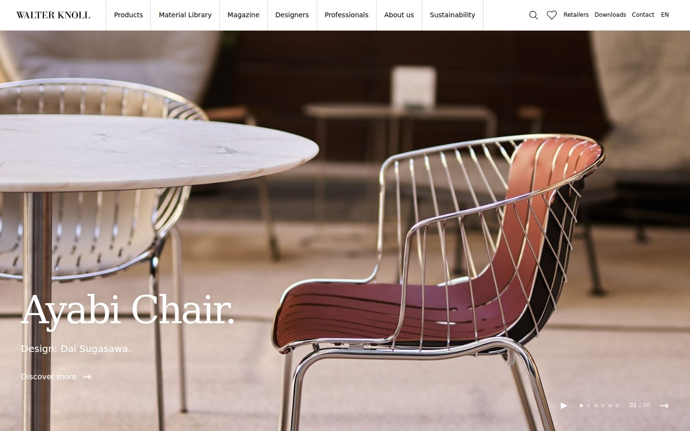

# Walter Knoll · Frontend Study

按 [Walter Knoll 英文官网](https://www.walterknoll.info/en) 与用户提供的十页分工表完成的响应式教学复刻。采用 **原生 HTML、CSS、JavaScript**，保留指定目录结构，旧 `runoob-ui-lab` 项目不受影响。



## 启动

```bash
npm install
npm run dev
```

打开 **http://localhost:4173**。运行时没有框架、构建工具或第三方 API；图片、产品与材料数据都在本地。服务器只使用 Node 标准库；安装的 Playwright 用于开发验证。

如需其他端口：`PORT=8080 npm run dev`。请通过 HTTP 服务打开，浏览器的 `file://` 模式不支持本项目的 ES modules 与 JSON 请求。

## 十个页面与分工

| 分工 | 页面 | 内容 |
| --- | --- | --- |
| A | `index.html` | 六张 Hero 轮播、产品推荐、Magazine、Worldwide/About、订阅演示 |
| A | `pages/about.html` | Purpose、历史时间轴、设计师、门店入口 |
| B | `pages/products.html` | 分类图片、分类/设计师/关键词筛选、加载更多、产品预览 |
| B | `pages/products-chairs.html` | 35 款座椅、9 款/页、分页与筛选 |
| C | `pages/materials.html` | 九个材料入口、悬停效果、材料预览、FAQ |
| C | `pages/materials-leathers.html` | Elen 大图、材料说明、15 款真实纹理色卡 |
| D | `pages/magazine.html` | All Topics / News / Stories / References、文章列表与预览 |
| D | `pages/professionals.html` | 八项服务、可下载的项目参考文件、官方资源入口 |
| E | `pages/sustainability.html` | 来源明确的统计、图文、原则与 Evo Concept |
| E | `pages/contact.html` | 六个门店、城市搜索、地图链接、联系表单演示 |

共享功能包括移动端菜单、跨页面搜索、产品心愿单、键盘操作、回到顶部。心愿单保存在当前浏览器；联系与订阅表单只验证输入并显示演示结果，不发送或保存个人信息。

产品索引有 60 条分类记录（59 个不同产品，Management-X 跨分类）；总览展示十个目前官网返回的产品分类。杂志保留九篇有官方来源的文章入口。产品与文章弹窗提供简介入口，完整产品规格和文章在原官网查看。

## 文件组织

```text
index.html                 首页
pages/                     九个内页
css/base.css               变量、重置、字体
css/layout.css             导航、页脚、网格、响应式
css/components.css         卡片、筛选、表单、弹窗
css/pages/                 每页专属样式
js/components/             公共导航与页脚的源片段
js/common.js               搜索、菜单、心愿单、公共弹窗
js/api.js                  本地数据读取与卡片输出
js/pages/                  页面交互
assets/data/catalog.json   产品、文章、材料、门店、轮播索引
assets/images/             本地图片，按模块分类
assets/downloads/          可下载的教学参考文件
scripts/                   启动、公共片段同步、检查、截图
```

修改导航或页脚后运行：

```bash
npm run sync:components
```

它把片段同步到十页，保留每页正确的资源前缀。导航和页脚在 HTML 中直接可见，不依赖运行时组件请求。

## 检查与截图

```bash
npm run check
npx playwright install chromium
npm test
```

- `check`：十页数量、共享片段一致性、内部链接、锚点、图片与 JavaScript 语法。
- `test`：自动启动独立测试服务器，检查十页桌面/手机布局和主要交互；完成后自动停止测试服务器。
- 报告与完整截图在 `artifacts/verification/`，不把临时测试产物加入 Git。
- `npm run capture:reference`：采集指定官网页面截图与字体/尺寸观察，保存到 `artifacts/reference/`。
- GitHub Actions 自动执行检查与浏览器测试，并上传测试报告。

实际执行结果见 [验证记录](docs/VERIFICATION.md)。开发方法、资料取舍见 [工程说明](docs/ENGINEERING.md)，素材来源见 [参考记录](docs/references/README.md)。

## 使用范围

这是独立教学练习，品牌、产品照片和材料纹理属于原权利人；不代表 Walter Knoll 官方服务，不用于商业经营。下载文件为本项目编写的学习资料。商业字体用 Georgia 与系统无衬线字体替代，因此字体字形、部分排版与原站存在差异。本轮交付 GitHub 源码，尚未发布公开访问的网站。
