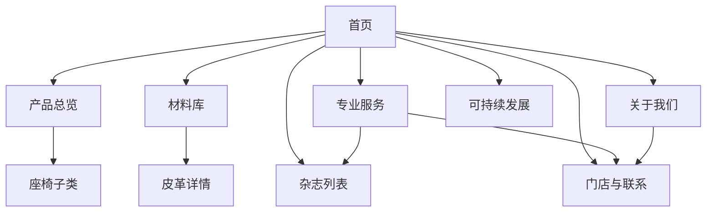
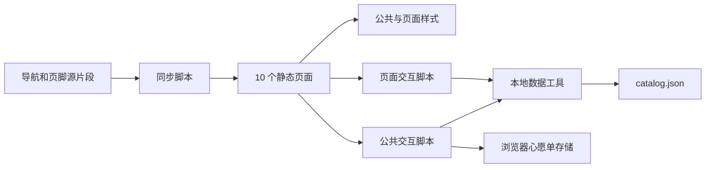
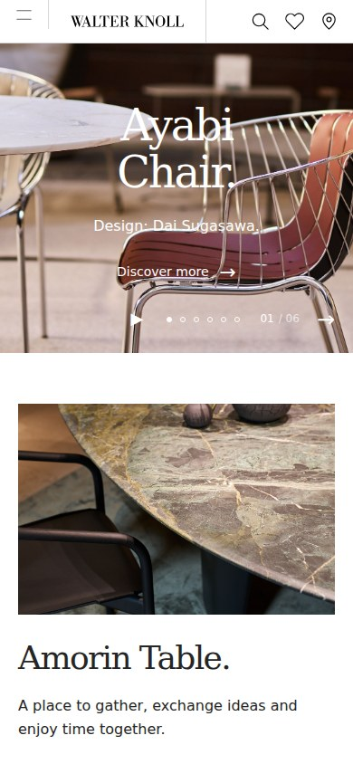

# Walter Knoll 网站复刻项目说明

本项目复刻 Walter Knoll 英文官网的主要页面。项目使用原生 HTML、CSS 和 JavaScript，实现 10 个响应式页面。页面覆盖产品、材料、杂志、品牌、专业服务、可持续发展和门店联系。

本说明用于项目交接、成员协作和课程演示。A 至 E 为成员分工代号，团队可补充实际姓名。下面列出的内容表示模块职责，实际提交记录以 Git 历史为准。

| 项目         | 说明                                                              |
| ------------ | ----------------------------------------------------------------- |
| 项目名称     | Walter Knoll 网站复刻                                             |
| 参考网站     | [Walter Knoll 英文官网](https://www.walterknoll.info/en)          |
| 代码仓库     | [railway02/walterknoll](https://github.com/railway02/walterknoll) |
| 页面语言     | 英文                                                              |
| 文档语言     | 中文                                                              |
| 团队规模     | 5 人，每人负责 2 个页面                                           |
| 技术方案     | 原生 HTML、CSS、JavaScript 和本地 JSON 数据                       |
| 默认访问地址 | `http://localhost:4173`                                           |
| 当前交付     | 10 个页面、交互脚本、本地素材、测试与项目文档                     |
| 文档更新日期 | 2026 年 10 月 14 日                                               |

## 目录

- [项目目标与范围](#项目目标与范围)
- [环境准备与启动](#环境准备与启动)
- [页面结构与访问路径](#页面结构与访问路径)
- [技术架构与目录](#技术架构与目录)
- [公共功能与视觉规范](#公共功能与视觉规范)
- [成员职责与实现内容](#成员职责与实现内容)
- [数据与素材维护](#数据与素材维护)
- [协作与版本管理](#协作与版本管理)
- [验证与演示](#验证与演示)
- [常见问题](#常见问题)
- [当前边界与后续改进](#当前边界与后续改进)
- [参考资料](#参考资料)

## 项目目标与范围

### 开发目标

项目以官网的版式和信息结构为参考。视觉重点包括大幅家具摄影、衬线标题、宽留白和细分隔线。页面保持统一的导航、页脚、配色和字体。

交互重点是让用户完成浏览流程。用户可以筛选产品、翻页、查看材料色卡、切换杂志分类和搜索门店。各页面通过实际链接连接，形成完整的网站入口。

工程重点是便于分工和维护。公共组件统一编辑，页面样式单独组织。产品等列表通过本地数据生成，开发者可以定位内容与交互的修改入口。

### 实现范围

本轮包括 10 个页面和公共交互。首页提供 5 个内容区；其余页面分别承担产品浏览、材料介绍和品牌展示等功能。网站通过本地 HTTP 服务运行。

联系表单和订阅表单用于演示输入验证。提交后显示本地演示结果，不发送邮件或创建官方订阅。产品规格、文章全文和专业资源通过链接访问原官网。

### 设计依据

目录结构来自用户提供的文本说明。页面分工来自 10 页任务表。压缩包提供初始骨架、Logo 和部分照片。首版在此基础上补齐内页和交互。

视觉实现以 2026 年 10 月 14 日的官网观察为准。例如，当前首页采用白色固定顶栏。产品总览保留官网当时返回的 10 个分类，未补造旧分工表中的展品数据。

## 环境准备与启动

### 所需环境

开发环境使用 Node.js 和 npm。建议采用 Node.js 24，与持续集成环境保持一致。本地验证使用 Node.js 24.10.0。

浏览页面需要支持 JavaScript 模块和原生 `dialog` 元素的现代浏览器。浏览器自动化验证使用 Playwright 1.55.0 和 Chromium。Playwright 是开发依赖，网站运行时不依赖它。

### 首次启动

在新目录中获取项目：

```bash
git clone https://github.com/railway02/walterknoll.git
cd walterknoll
npm ci
npm run dev
```

当前工作区已有项目时，进入本地目录：

```bash
cd /home/railway/projects/cainiao/walterknoll
npm run dev
```

浏览器打开 `http://localhost:4173`。服务器支持直接访问首页和 `pages/` 下的内页。终端按 `Ctrl+C` 停止服务。

### 端口配置

Linux 或 macOS 可以通过 `PORT` 修改端口：

```bash
PORT=8080 npm run dev
```

Windows PowerShell 使用：

```powershell
$env:PORT = '8080'
npm run dev
```

此时访问 `http://localhost:8080`。浏览器测试默认使用独立的 4174 端口。

### 常用命令

| 命令                        | 用途                               |
| --------------------------- | ---------------------------------- |
| `npm run dev`               | 启动本地静态服务器                 |
| `npm run sync:components`   | 将公共导航和页脚同步到 10 个页面   |
| `npm run check`             | 检查内部链接、资源、锚点和脚本语法 |
| `npm test`                  | 启动测试服务器，执行浏览器检查     |
| `npm run capture:reference` | 采集指定官网页面的截图和布局观察   |

页面使用 JavaScript 模块和本地数据请求。请通过 HTTP 地址访问，直接双击 HTML 文件的 `file://` 模式不适用于本项目。

## 页面结构与访问路径

| 成员 | 页面       | 相对访问路径                     | 主要功能                                     |
| ---- | ---------- | -------------------------------- | -------------------------------------------- |
| A    | 首页       | `/index.html`                    | 轮播、产品推荐、杂志入口、品牌介绍、订阅演示 |
| A    | 关于我们   | `/pages/about.html`              | 品牌介绍、历史时间轴、设计师和门店入口       |
| B    | 产品总览   | `/pages/products.html`           | 分类入口、组合筛选、加载更多、产品预览       |
| B    | 产品子类   | `/pages/products-chairs.html`    | 座椅网格、面包屑、筛选和分页                 |
| C    | 材料库     | `/pages/materials.html`          | 9 个材料入口、悬停效果、预览和常见问题       |
| C    | 皮革详情   | `/pages/materials-leathers.html` | 材料说明、大图、15 款色卡和相关材料          |
| D    | 杂志列表   | `/pages/magazine.html`           | 分类标签页、文章列表和文章预览               |
| D    | 专业服务   | `/pages/professionals.html`      | 8 项服务、下载列表和官方资源入口             |
| E    | 可持续发展 | `/pages/sustainability.html`     | 统计、图文说明、原则和证书入口               |
| E    | 门店与联系 | `/pages/contact.html`            | 6 个门店、搜索、地图链接和联系表单           |

首页是主要入口。产品页连接座椅子类，材料库连接皮革详情。导航中的 Designers（设计师）指向关于页的设计师区。Retailers（门店）和 Contact（联系）分别指向联系页的对应区块。



部分列表支持地址参数，便于直接展示指定内容：

| 示例路径                                                   | 打开后的行为                   |
| ---------------------------------------------------------- | ------------------------------ |
| `/pages/products.html?category=tables#collection`          | 选择桌类产品，并定位到产品列表 |
| `/pages/products.html?product=ayabi-chair`                 | 打开 Ayabi Chair 产品预览      |
| `/pages/magazine.html?category=References`                 | 显示项目案例类文章             |
| `/pages/magazine.html?article=retreat-park-am-see-nattika` | 打开对应文章预览               |
| `/pages/about.html#history`                                | 定位到发展历程                 |
| `/pages/contact.html#retailers`                            | 定位到门店列表                 |

## 技术架构与目录

### 页面与脚本关系

HTML 保存页面结构和静态内容。CSS 负责排版与响应式布局。JavaScript 处理菜单、筛选、分页、弹窗和表单验证。

产品列表、杂志列表、搜索和轮播读取 `catalog.json`。`js/api.js` 封装数据请求，并复用同一页面内的请求结果。这个文件是前端数据工具，不是后端接口服务。

公共导航和页脚采用构建前同步的方式。开发者编辑片段后运行同步脚本。脚本将内容写入静态 HTML，并调整根目录与内页的相对路径。



### 主要目录

```text
walterknoll/
├── index.html
├── README.md
├── AGENTS.md
├── package.json
├── package-lock.json
├── pages/                  九个内页
├── css/
│   ├── base.css            基础样式
│   ├── layout.css          公共布局
│   ├── components.css      复用组件
│   └── pages/              十页专属样式
├── js/
│   ├── api.js              数据与卡片工具
│   ├── common.js           公共交互
│   ├── components/         导航和页脚源片段
│   └── pages/              页面交互脚本
├── assets/
│   ├── data/catalog.json   内容索引
│   ├── images/             页面摄影与纹理
│   ├── icons/              图标资源
│   ├── fonts/              字体资源预留目录
│   └── downloads/          教学参考文件
├── scripts/                服务、同步、检查和截图工具
├── docs/                   需求、说明和验证记录
└── .github/workflows/      持续集成配置
```

### CSS 分层

每页按以下顺序引入样式。后面的页面样式可以覆盖前面的公共规则。

| 层次   | 文件                   | 职责                                 |
| ------ | ---------------------- | ------------------------------------ |
| 基础层 | `css/base.css`         | 颜色、字体、重置、通用排版和基础断点 |
| 布局层 | `css/layout.css`       | 导航、页脚、容器、网格和区块布局     |
| 组件层 | `css/components.css`   | 卡片、按钮、筛选、分页、表单和弹窗   |
| 页面层 | `css/pages/页面名.css` | 时间轴、色卡和页面专属布局           |

## 公共功能与视觉规范

### 导航与页脚

桌面导航提供主要栏目和工具入口。窄屏显示菜单按钮，点击后打开抽屉。抽屉支持键盘关闭和页面跳转，菜单按钮同步显示展开状态。

页脚提供产品、材料、品牌、专业服务和杂志链接。页脚还包含项目用途说明、原官网入口和回到顶部按钮。

公共组件的编辑入口是 [header.html](../js/components/header.html) 和 [footer.html](../js/components/footer.html)。页面中同步生成的区域不作为日常编辑入口。

### 搜索与心愿单

全站搜索匹配产品、页面入口和杂志文章。用户输入名称后，可以从结果打开对应页面。没有匹配结果时，窗口显示空状态和搜索建议。

产品心愿单使用浏览器 `localStorage` 保存产品标识。收藏按钮和顶栏数量保持同步。刷新后可以继续查看收藏；数据只保存在当前浏览器。

搜索、收藏和产品预览由 [common.js](../js/common.js) 管理。卡片生成函数位于 [api.js](../js/api.js)。B 成员维护产品页面时，需要保持两者的调用关系。

### 字体与配色

项目使用黑色、白色和灰阶。标题采用 Georgia，正文采用系统无衬线字体。官网商业字体未纳入项目，因此文字宽度和字形存在差异。

| 样式项               | 当前取值或规则     |
| -------------------- | ------------------ |
| 主文字颜色           | `#252525`          |
| 页面背景             | `#ffffff`          |
| 浅灰背景             | `#f5f5f3`          |
| 分隔线               | 黑色，透明度为 16% |
| 桌面基础顶栏高度     | 64 px              |
| 平板与手机顶栏高度   | 48 px              |
| 1440 px 视口左右留白 | 各 44 px           |
| 常规内页主标题       | 56 px，窄屏缩小    |
| 桌面首页主标题       | 80 px，窄屏缩小    |

### 响应式与键盘操作

基础断点为 479 px、859 px、1199 px 和 1700 px。部分组件另设 599 px 等断点，用于调整网格和横向内容。修改布局时，应同时检查断点两侧。

图片网格随视口变化调整列数。手机页面采用单列或适合小卡片的多列布局。标题、留白和表单宽度同步缩小。

公共功能支持可见的键盘焦点。弹窗使用原生 `dialog`，支持 `Escape` 关闭。杂志标签页支持方向键、`Home` 和 `End`。系统启用减少动态效果时，首页轮播默认暂停。

## 成员职责与实现内容

### 成员 A 首页与关于我们

A 负责网站入口和品牌介绍。首页是视觉基准，也连接其他成员的页面。A 同时承担公共导航和页脚的协调维护。

**首页内容。** 首屏展示 6 张家具照片，支持手动切换和暂停。自动轮播间隔为 6 秒，切换时同步标题、设计师说明和跳转入口。页面隐藏时停止自动切换。

首页其余内容包括 2 个产品推荐、3 个杂志入口、品牌与门店介绍，以及订阅演示。产品入口连接 B 的页面，杂志入口连接 D 的页面，门店入口连接 E 的页面。

**关于页内容。** 页面包含品牌介绍、历史时间轴和设计师区。时间轴选取 1865 年、1925 年、1949 年和 1985 年的节点。设计师区展示 EOOS 和 Foster + Partners 的入口内容。

| 负责文件                                       | 用途                     |
| ---------------------------------------------- | ------------------------ |
| [index.html](../index.html)                    | 首页 5 个内容区          |
| [about.html](../pages/about.html)              | 品牌、历史和设计师内容   |
| [index.css](../css/pages/index.css)            | 首屏、轮播控件和首页布局 |
| [about.css](../css/pages/about.css)            | 时间轴和关于页布局       |
| [index.js](../js/pages/index.js)               | 轮播状态和切换逻辑       |
| `assets/images/index/`、`assets/images/about/` | 首页和品牌图片           |

A 修改轮播内容时，应维护 `catalog.json` 的 `slides` 字段。默认首屏内容保存在 HTML 中，也应与首张轮播记录一致。关于页主要使用静态 HTML。

**协作内容。** A 协调导航、页脚和公共布局。调整公共片段后，运行同步命令。B、C、D、E 的页面名称或锚点变化时，A 更新相应入口。

**演示与验收。**

1. 打开首页，切换到第二张图，检查图片和标题同步变化。
2. 暂停轮播，再选择第一张图，确认仍可手动切换。
3. 点击产品、杂志和门店入口，确认进入相应页面。
4. 打开关于页，使用子导航定位历史和设计师区。
5. 在手机宽度打开菜单，再打开订阅窗口，确认内容可操作。

### 成员 B 产品总览与座椅子类

B 负责产品浏览流程。用户先从分类选择产品，再通过筛选和分页缩小范围。两个页面复用同一套产品脚本和公共卡片。

**产品总览内容。** 页面上部展示 10 个分类入口。下部提供分类、设计师和关键词筛选。列表首次展示 12 个产品，每次加载更多增加 12 个。

筛选条件共同作用于列表。条件变化后更新数量和卡片。无匹配产品时显示空状态；重置按钮恢复默认筛选。

**座椅子类内容。** 页面固定使用 Chairs & Barstools（椅子与吧凳）分类。当前数据包含 35 款产品，每页展示 9 款，共 4 页。最后一页展示 8 款产品。

分页按钮支持首尾边界。筛选后重新计算页数，并返回第一页。产品图片和名称可以打开预览，心形按钮可以加入公共心愿单。

| 负责文件                                                | 用途                 |
| ------------------------------------------------------- | -------------------- |
| [products.html](../pages/products.html)                 | 分类入口和产品总览   |
| [products-chairs.html](../pages/products-chairs.html)   | 座椅列表和分页容器   |
| [products.css](../css/pages/products.css)               | 总览分类与卡片网格   |
| [products-chairs.css](../css/pages/products-chairs.css) | 座椅网格和分页布局   |
| [products.js](../js/pages/products.js)                  | 筛选、加载更多和分页 |
| `assets/images/products/`                               | 分类图片和产品图片   |

B 维护 `catalog.json` 的 `products` 和 `categories` 字段。产品卡片通过 `productCard()` 输出。列表按产品 `id` 去重，新增跨分类记录时需检查实际筛选结果。

**协作内容。** B 与 A 保持搜索、预览和心愿单接口一致。产品分类链接供首页、页脚和专业服务使用。B 与 C 协调产品预览中的材料入口扩展。

**演示与验收。**

1. 打开总览，点击加载更多，确认卡片数量增加。
2. 选择 Tables（桌类），再选择 Wolfgang C. R. Mezger，查看组合筛选结果。
3. 输入无匹配关键词，检查空状态，再点击重置。
4. 打开座椅页，查看第 2 页和第 4 页，确认产品发生变化。
5. 在首尾页检查翻页按钮，打开产品预览并收藏，刷新后查看心愿单。

### 成员 C 材料库与皮革详情

C 负责材料的视觉展示和颜色选择。材料库介绍材料类别，皮革页展示具体纹理和颜色。内容重点是让用户看到材料差异。

**材料库内容。** 页面包括首屏大图、材料介绍和 9 个入口。入口分别为皮革、织物、补充织物、木材、石材、其他表面、灵感、应用场景和常见问题。

皮革入口进入本地详情页。其余卡片可以打开材料预览，预览提供原官网链接。页面底部通过原生 `details` 元素展示常见问题。

**皮革详情内容。** 页面介绍 Elen 皮革，展示材料类型、厚度和选中颜色。当前页面包含 15 款真实纹理色卡，默认选择 `1225 cognac`。

点击色卡后，大图、图片说明和选中色名同步变化。页面底部连接织物、木材和石材入口。颜色效果用于屏幕预览，最终选择应参考实物样本。

| 负责文件                                                      | 用途                 |
| ------------------------------------------------------------- | -------------------- |
| [materials.html](../pages/materials.html)                     | 材料卡片和常见问题   |
| [materials-leathers.html](../pages/materials-leathers.html)   | Elen 介绍与色卡      |
| [materials.css](../css/pages/materials.css)                   | 材料网格、悬停和预览 |
| [materials-leathers.css](../css/pages/materials-leathers.css) | 纹理大图与色卡布局   |
| [materials.js](../js/pages/materials.js)                      | 材料预览窗口         |
| [materials-leathers.js](../js/pages/materials-leathers.js)    | 色卡选择和图片同步   |
| `assets/images/materials/`                                    | 材料照片和皮革纹理   |

材料卡片和色卡按钮当前保存在静态 HTML 中。`catalog.json` 的 `leathers` 字段保留纹理索引。维护色卡时，应核对 HTML、索引和图片路径。

**协作内容。** C 与 A 保持公共弹窗样式一致。材料页的门店入口连接 E 的页面。新增材料入口时，检查页脚和相关材料链接。

**演示与验收。**

1. 打开材料库，在桌面观察卡片悬停效果。
2. 打开 Fabrics（织物）预览，再通过皮革入口进入详情页。
3. 点击 `1217 atlantic`，确认大图、说明和色名变化。
4. 用键盘选择其他色卡，检查焦点和选中状态。
5. 展开常见问题，并在手机宽度检查色卡和图片布局。

### 成员 D 杂志列表与专业服务

D 负责内容浏览和专业资源入口。杂志呈现设计故事与项目案例，专业服务页连接下载、规划工具和联系渠道。

**杂志列表内容。** 页面提供 All Topics（全部）、News（新闻）、Stories（故事）和 References（项目案例）4 个标签页。当前索引包含 9 篇文章，每个具体分类各有 3 篇。

标签页切换时更新文章和数量。图片、标题和按钮都可以打开文章预览。预览保留原文入口，完整文章在原官网阅读。

**专业服务内容。** 页面提供 8 项服务：下载、项目、学习中心、展厅、媒体、联系、pCon 工具和内容资源。部分入口定位本页区块，部分入口访问本地页面或原官网。

下载列表包含项目指南、材料笔记和护理参考 3 个文本文件。这些文件属于本项目的教学资料。官方 CAD 数据、产品规格和宣传册通过原站下载入口获取。

| 负责文件                                                  | 用途                         |
| --------------------------------------------------------- | ---------------------------- |
| [magazine.html](../pages/magazine.html)                   | 标签页和文章列表容器         |
| [professionals.html](../pages/professionals.html)         | 服务卡片与下载列表           |
| [magazine.css](../css/pages/magazine.css)                 | 标签页、文章行与预览         |
| [professionals.css](../css/pages/professionals.css)       | 服务卡片和资源布局           |
| [magazine.js](../js/pages/magazine.js)                    | 分类切换、键盘操作和文章预览 |
| `assets/images/magazine/`、`assets/images/professionals/` | 文章与专业服务图片           |
| `assets/downloads/`                                       | 3 个教学参考文件             |

D 维护 `catalog.json` 的 `articles` 字段。专业服务页主要使用静态 HTML 和浏览器原生下载功能，当前没有独立的 `professionals.js`。

**协作内容。** D 为 A 的首页提供杂志入口。项目案例使用分类参数直接访问。服务页的展厅和联系入口由 E 的页面承接。

**演示与验收。**

1. 依次选择 News、Stories 和 References，检查内容与数量。
2. 使用方向键切换标签页，并检查焦点移动。
3. 打开文章预览，确认标题和原文链接对应。
4. 下载 Project guide（项目指南），确认文件可保存并包含实际内容。
5. 点击项目、展厅和联系入口，检查跳转目标。

### 成员 E 可持续发展与门店联系

E 负责可持续内容和联系入口。可持续页介绍品牌的长期设计思路，联系页帮助用户找到门店，并演示咨询流程。

**可持续页内容。** 页面包括章节导航、统计区和交替图文区。统计展示 1865 年的品牌历史起点、9 项产品原则和 2019 年的环境管理节点。每项统计附有官方来源。

图文内容覆盖产品生命周期、工艺与责任、环境管理和 Evo Concept（产品持续发展概念）。证书和更详细的说明通过原官网入口访问。

**门店联系内容。** 页面展示总部和 5 个选定品牌空间。地点为 Herrenberg、New York City、London、Berlin、Kuala Lumpur 和 Wallisellen。

门店搜索匹配城市、名称和地址。搜索后更新可见卡片和数量。无匹配门店时显示提示；地图入口在新窗口打开外部地图。

联系表单包含姓名、邮箱、主题、留言和演示确认选项。浏览器检查必填项与邮箱格式，脚本补充姓名和留言的空白校验。通过验证后，页面提示消息未发送，并清空输入。

| 负责文件                                                  | 用途                 |
| --------------------------------------------------------- | -------------------- |
| [sustainability.html](../pages/sustainability.html)       | 统计、图文和来源链接 |
| [contact.html](../pages/contact.html)                     | 门店、搜索和联系表单 |
| [sustainability.css](../css/pages/sustainability.css)     | 统计和图文布局       |
| [contact.css](../css/pages/contact.css)                   | 门店卡片与表单样式   |
| [contact.js](../js/pages/contact.js)                      | 门店过滤和表单验证   |
| `assets/images/sustainability/`、`assets/images/contact/` | 可持续与门店照片     |

门店卡片目前保存在 `contact.html` 中。`catalog.json` 的 `stores` 字段保存参考门店，和页面选取的 6 个地点不是完全相同的集合。修改展示信息时，应直接核对页面卡片。

**协作内容。** E 承接 A、C、D 的门店与联系入口。新增可持续数字时，E 提供来源链接，并同步说明统计含义。公共订阅窗口由 A 协调，联系表单由 E 维护。

**演示与验收。**

1. 使用章节导航定位可持续区块，检查统计来源入口。
2. 搜索 `New York`，确认只显示对应门店。
3. 搜索不存在的城市，再清空搜索，确认空状态和恢复行为。
4. 提交空表单和错误邮箱，检查浏览器提示。
5. 填写有效内容并提交，确认出现本地演示结果，且不发送消息。

## 数据与素材维护

### 数据集合

本地索引位于 [catalog.json](../assets/data/catalog.json)。页面读取哪些字段，取决于具体脚本。静态页面内容仍需在对应 HTML 中维护。

| 字段         | 当前数量 | 内容与主要使用位置                     |
| ------------ | -------- | -------------------------------------- |
| `products`   | 60 条    | 产品分类记录，产品列表、搜索和预览使用 |
| `categories` | 10 条    | 分类名称、标识和图片，产品筛选使用     |
| `leathers`   | 15 条    | Elen 纹理索引，供色卡内容核对          |
| `articles`   | 9 条     | 文章标题、分类、图片和原文入口         |
| `stores`     | 6 条     | 参考门店记录，展示页另选总部和品牌空间 |
| `slides`     | 6 条     | 首页图片、标题、说明和分类入口         |

60 条产品分类记录对应 59 个不同产品。Management-X 在多个分类中出现。当前列表按 `id` 去重，分类记录数量不直接等于页面展示数量。

### 修改方法

新增产品时，B 先加入本地图片，再填写产品标识、名称、分类和原文链接。已有产品使用稳定的 `id`，避免影响搜索入口和心愿单。

新增文章时，D 填写对应分类和原文地址。使用当前 3 个具体分类之一，才能通过标签页筛选。文章没有维护发布日期，因此展示时不补造日期。

新增色卡时，C 更新纹理图片、`leathers` 索引和详情页按钮。按钮的 `data-swatch` 记录色名，内部图片作为预览来源。

新增门店时，E 更新静态卡片中的名称、地址、联系方式和地图入口。搜索使用卡片文字，新增内容会参与匹配。

### 图片路径与来源

图片按页面模块放入 `assets/images/`。首页资源路径从根目录开始，内页相对引用使用 `../`。JavaScript 通过 `asset()` 统一解析资源地址。

新下载图片的来源记录位于 [assets.json](references/assets.json)。原压缩包素材和官网页面对应关系见 [参考记录](references/README.md)。素材更新时，应保留可识别的名称和来源。

## 协作与版本管理

### 修改边界

成员优先修改自己负责的 HTML、页面 CSS 和页面脚本。公共导航、页脚和基础布局由 A 协调。公共数据按字段分工，修改时保持 JSON 结构和其他字段内容。

公共样式承载跨页面规则。只有多个页面需要同一行为时，才将规则提取到公共层。时间轴、皮革色卡等专属规则保留在页面层。

### 日常提交

每次提交围绕一个明确结果，例如产品筛选调整或材料图片更新。提交前查看差异，检查文件是否属于本次修改。

以下命令以 A 的首页调整为例。分支名和提交说明应按实际任务修改。

```bash
git switch main
git pull --ff-only
git switch -c feat/a-home-layout

# 完成页面修改后，检查并提交。
npm run check
git diff
git add index.html css/pages/index.css
git commit -m "fix: adjust homepage layout on mobile"
git push -u origin feat/a-home-layout
```

修改公共片段时，先运行 `npm run sync:components`。提交时包含源片段和同步后的页面。调整交互或响应式布局后，执行对应浏览器检查。

### 合并与冲突处理

合并前阅读实际差异，重点检查公共组件、资源路径和数据字段。冲突处理后，确认所有页面仍使用相同的公共片段。

公共片段发生冲突时，先确定片段内容，再运行同步命令生成页面。JSON 冲突应按字段处理，保留其他成员的数据。完成合并后检查受影响的用户流程。

## 验证与演示

### 检查命令

首次执行浏览器测试前，安装 Chromium：

```bash
npm ci
npx playwright install chromium
npm run check
npm test
```

Linux 环境需要同时安装浏览器系统依赖时，可使用 `npx playwright install --with-deps chromium`。GitHub Actions 已采用此方式。

`npm run check` 检查 10 页数量、共享组件、内部链接、锚点和资源。它也检查 JavaScript 语法。检查结果用于发现结构错误，不评价视觉相似度。

`npm test` 自动启动独立服务器。测试完成后停止服务器，并保存结果与截图。产物位于 `artifacts/verification/`，默认由 Git 忽略。

### 已执行结果

当前页面实现通过 35 项浏览器检查。每页分别检查 1440 × 900 px 和 390 × 844 px 两种视口，共 20 个页面视口。检查覆盖图片、页面宽度、脚本错误和本地资源请求。

其余检查覆盖菜单、搜索、筛选、分页、预览、收藏、标签页、色卡、下载和表单。首页还检查了 320 px、859 px、1199 px 和 1200 px 的布局宽度。

详细记录见 [验证说明](VERIFICATION.md) 和 [浏览器结果](verification/browser-results.json)。首版的 [GitHub Actions 检查](https://github.com/railway02/walterknoll/actions/runs/38519327206) 也已通过。后续修改应查看对应提交的检查结果。

### 团队演示顺序

| 顺序 | 演示成员 | 演示内容                       |
| ---- | -------- | ------------------------------ |
| 1    | A        | 首页视觉、轮播、导航和品牌介绍 |
| 2    | B        | 产品筛选、分页、预览和收藏     |
| 3    | C        | 材料入口、纹理大图和颜色切换   |
| 4    | D        | 杂志分类、文章预览和资源下载   |
| 5    | E        | 可持续来源、门店搜索和表单验证 |
| 6    | 全体     | 手机视口、页面互通和测试结果   |

演示时先展示用户操作，再说明对应代码入口。说明测试结果时，区分本地演示、官方外链和已实现的页面功能。

### 页面截图

桌面首页截图：


手机首页截图：



## 常见问题

| 问题                   | 处理方法                                                   |
| ---------------------- | ---------------------------------------------------------- |
| 页面没有加载列表       | 使用 HTTP 地址访问，检查 `catalog.json` 请求和浏览器控制台 |
| 图片显示失败           | 核对相对路径和大小写，再运行 `npm run check`               |
| 导航修改后其他页未更新 | 编辑公共片段，再运行 `npm run sync:components`             |
| 启动时报端口占用       | 通过 `PORT` 选择其他端口                                   |
| 浏览器测试无法启动     | 安装 Playwright 对应的 Chromium，检查系统依赖和 4174 端口  |
| 修改 JSON 后页面报错   | 检查逗号、引号和字段结构，保持合法 JSON                    |
| 页面布局影响其他成员   | 判断规则是否误放公共层，将专属规则移到页面 CSS             |
| 刷新后心愿单发生变化   | 检查浏览器是否清理站点存储，或是否切换访问地址             |
| 联系表单没有收到邮件   | 当前实现只演示本地验证，实际咨询使用官网联系入口           |

## 当前边界与后续改进

### 当前边界

项目复刻主要布局与浏览交互。它使用选定的产品和文章子集。详情窗口提供索引和原站入口，完整规格与全文由原官网提供。

当前验证基于 Chromium，尚未覆盖 Firefox 和 Safari。图片与颜色在不同设备上的效果可能不同。系统字体替代也会影响字形和换行。

仓库已上传 GitHub，当前交付为源码和本地运行方式。品牌、产品摄影和材料纹理归原权利人所有，本项目用于教学演示。

### 后续改进

后续可以将静态色卡和门店改为统一数据生成，减少重复维护。跨分类产品可以改为保留多个分类关联，避免去重后丢失分类归属。

体验方面可以补充独立产品详情页和文章详情页。新增详情应使用来源明确的内容，并补充对应检查。浏览器兼容性和大屏展示也可继续验证。

## 参考资料

- [Walter Knoll 英文官网](https://www.walterknoll.info/en)：页面视觉与内容入口。
- [阮一峰中文技术文档写作规范](https://github.com/ruanyf/document-style-guide)：标题层级、段落、数字、标点和文件命名。
- [生成式软件工程课程](https://jyywiki.cn/GSE/2026/)：需求、版本管理、架构和实际验证方法。
- [项目范围](SPEC.md)：本轮页面与功能约定。
- [工程说明](ENGINEERING.md)：资料取舍和实现方式。
- [A 至 E 分工入口](%E5%88%86%E5%B7%A5%E6%96%B9%E6%A1%88.md)：各模块的维护入口。
- [参考记录](references/README.md)：官网路径和素材来源。
